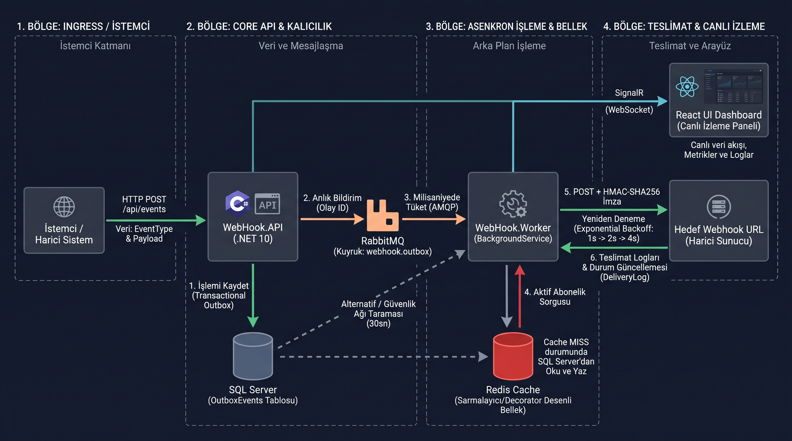

# ⚡ WebHook Engine — Asenkron Olay Dağıtım ve Teslimat Motoru



**WebHook Engine**; yüksek güvenilirlikli, düşük gecikmeli ve güvenli asenkron webhook teslimatı sağlamak amacıyla **.NET 10**, **Clean Architecture**, **Transactional Outbox Pattern**, **RabbitMQ**, **Redis** ve **React** kullanılarak geliştirilmiş uçtan uca bir olay dağıtım platformudur.

---


## ✨ Temel Özellikler ve Mühendislik Kararları

- **Transactional Outbox & Hibrit Kuyruk Mimarisi:** Gelen her olay önce SQL Server'daki `OutboxEvents` tablosuna kalıcı olarak yazılır, ardından Worker'ı anında uyandırmak için RabbitMQ kuyruğuna iletir. Olası bir mesaj kuyruğu kesintisine karşı Worker üzerindeki periyodik güvenlik ağı (*fallback sweep*) işlenmemiş kayıtları otomatik devralır.
- **Decorator Pattern ile Redis Önbellekleme:** `ISubscriptionRepository` arayüzü `CachedSubscriptionRepository` ile sarmalanarak aktif abonelikler RAM üzerinde tutulur. Yeni abonelik eklendiğinde veya güncellendiğinde ilgili önbellek anahtarı otomatik olarak geçersiz kılınır (*Cache Invalidation*).
- **HMAC-SHA256 Kriptografik İmzalama:** Her teslimat isteği, aboneliğe özel üretilen gizli anahtar (`whsec_...`) ile `sha256=<hex>` formatında imzalanarak alıcı tarafın veri bütünlüğünü ve kaynağını doğrulamasına olanak tanır.
- **Exponential Backoff ile Otomatik Yeniden Deneme:** Hedef uç noktanın `2xx` dışında yanıt döndürmesi veya zaman aşımına uğraması durumunda teslimat 3 denemeye kadar artan bekleme süreleriyle (`1s → 2s → 4s`) tekrarlanır.
- **Gerçek Zamanlı İzleme (SignalR + React):** Tüm teslimat denemeleri, HTTP durum kodları, payload içerikleri ve başarı metrikleri SignalR üzerinden anlık olarak React kontrol paneline aktarılır.
- **Birim Testleri (xUnit & Moq):** Kriptografik imza tutarlılığı ve abonelik iş kuralları izole birim testleriyle güvence altına alınmıştır.

---

## 🛠️ Teknoloji Yığını

| Katman / Alan | Teknolojiler |
| :--- | :--- |
| **Backend & Worker** | C#, .NET 10, ASP.NET Core Web API, BackgroundService, SignalR |
| **Mimari & Desenler** | Clean Architecture, Transactional Outbox, Decorator Pattern, Repository Pattern |
| **Veritabanı & ORM** | Microsoft SQL Server, Entity Framework Core |
| **Mesaj Kuyruğu & Önbellek** | RabbitMQ (`RabbitMQ.Client`), Redis (`StackExchangeRedis`) |
| **Frontend** | React, TypeScript, Vite, Tailwind CSS |
| **Test & Altyapı** | xUnit, Moq, Docker & Docker Compose |

---

## 📂 Proje Yapısı

```text
WebHook/
├── WebHook.Domain/          # Varlıklar (Entities) ve Repository arayüzleri
├── WebHook.Application/     # İş kuralları, DTO'lar, servisler ve port arayüzleri
├── WebHook.Infrastructure/  # EF Core, SQL Server, Redis Decorator, RabbitMQ Publisher, HMAC
├── WebHook.API/             # REST uç noktaları ve SignalR Hub
├── WebHook.Worker/          # RabbitMQ dinleyici, Outbox işleyici ve HTTP teslimat motoru
├── WebHook.Tests/           # xUnit ve Moq birim testleri
├── webhook-ui/              # React + TypeScript canlı izleme arayüzü
└── docker-compose.yml       # RabbitMQ ve Redis konteyner yapılandırması
```

---

## 🚀 Kurulum ve Çalıştırma

### Gereksinimler
- [.NET 10 SDK](https://dotnet.microsoft.com/)
- [Docker Desktop](https://www.docker.com/products/docker-desktop/)
- [Node.js (v20+ LTS)](https://nodejs.org/)
- SQL Server / LocalDB

### 1. Altyapı Servislerini Başlatın (RabbitMQ & Redis)
Proje ana dizininde terminali açarak Docker konteynerlerini ayağa kaldırın:

```bash
docker compose up -d
```
- **RabbitMQ Yönetim Paneli:** `http://localhost:15672` *(Kullanıcı: `guest` / Şifre: `guest`)*
- **Redis Portu:** `localhost:6379`

### 2. Veritabanı Migrasyonlarını Uygulayın
`WebHook.API` veya `WebHook.Infrastructure` katmanı üzerinden SQL Server tablolarını oluşturun:

```bash
dotnet ef database update --project WebHook.Infrastructure --startup-project WebHook.API
```

### 3. Backend ve Worker Servislerini Çalıştırın
```bash
# Terminal 1 — API ve SignalR Sunucusu
dotnet run --project WebHook.API

# Terminal 2 — Asenkron Teslimat İşçisi
dotnet run --project WebHook.Worker
```

### 4. React Kontrol Panelini Başlatın
```bash
cd webhook-ui
npm install
npm run dev
```
Tarayıcıda **`http://localhost:5173`** adresini açarak abonelik oluşturabilir, test olayları tetikleyebilir ve teslimat akışını canlı izleyebilirsiniz.

---

## 🧪 Testleri Çalıştırma

```bash
dotnet test
```